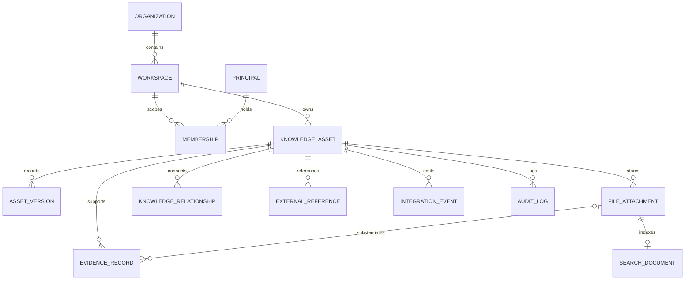

# Architecture and trust boundaries

The following is the Phase 1 design record. Phase 2 adds scoped templates, folded search, document passage indexing, file quotas, rate limits and a Memoire receiver. [Updated architecture and controls](phase2.md)

React/Vite serves a responsive desktop-first client. A same-origin Express application authenticates sessions and API credentials, validates versioned commands, and uses PostgreSQL transactions. Both local PGlite and the hosted PostgreSQL adapter execute the same domain SQL and migrations. A standalone Vercel handler accepts server-side configuration. The local process binds only to loopback.

## Persistence and authority

Asset metadata covers owner, organization, workspace, classification, lifecycle, verification, revision, review dates, readable summary and typed fields. Each scoped foreign key includes the workspace. The database binds the organization to the workspace. Immutable version snapshots preserve the outgoing state and references observed at write time. Inbound links on current details are computed live. The MVP requires a reviewer to return a published asset to draft before editing, which withdraws the release from consumers.

Review decisions use governed transitions with actor, version, review time and audit action. A distinct review-assignment table is deferred. Source citations use evidence rows with claim, passage, source label/URL and optional composite foreign key to a specific original. Taxonomy terms support domain, collection and tag vocabularies. Assets retain their collection label and searchable tags. Nested collection tables, tag aliases and custom asset-type creation are deferred. Saved views are scoped by workspace and principal.

The private file store uses PostgreSQL binary columns under RLS. This keeps the original, digest, metadata, version event and text index in one transaction. Downloads require a current member on every request and use forced attachment disposition. Text previews render escaped characters. Binary Office and PDF originals are downloadable. Text indexing uses the first 64,000 characters. OCR, binary document extraction, dedicated object storage, antivirus and retention policies remain release work.

## Threat model

| Risk | Implemented boundary | Residual consideration |
|---|---|---|
| Cross-tenant reads and inference | Server-verified membership, transaction-local context, non-owner runtime role, RLS, composite keys and workspace-local event cursors. Aggregates, files, evidence, graph and feed use the same context. | Operators with migration credentials are trusted. Never distribute database logins to clients. |
| Forged identity and privilege escalation | High-entropy hashed access tokens, expiring HTTP-only same-site sessions, origin checks, isolated consumer roles. Optional server verification against the configured Supabase issuer. Scoped admin functions validate roles and existing membership. | Approve subject bindings, TLS, key rotation, SSO sign-in UX, rate limits and offboarding before hosting. The local pilot shortcut is for synthetic data. |
| Insecure file access | Authenticated reads, no public object path, validated filenames and file signatures, 4 MiB cap, bounded ZIP expansion. XLSX parsing runs in a time- and heap-limited worker. | Format validation does not certify malware safety. Large or suspicious files need quarantine and scanning. |
| Forged integration events and connector misuse | The database writes the event in the asset transaction. Service consumers authenticate to the feed. No inbound event endpoint accepts arbitrary event envelopes. Consumer RLS requires published and shareable records. | Provision each real service identity with an approved workspace. A tenant consumer can read every shareable published record in that workspace. |
| Unauthorized AI retrieval or prompt injection | Retrieval runs as the human principal. Excerpts and uploaded text render as data. Offline operation sends no content to an AI provider. | Model and embedding interfaces exist. An approved provider, consent, passage-bound citations, conflict handling and model evaluations are prerequisites to enable generation. |
| Data poisoning and lost updates | Imports create new unverified drafts, all-or-nothing batch writes, conditional versions, constrained review transitions, and mandatory evidence before verification. | Human reviewers establish source quality. Synthetic material and analyst hypotheses carry explicit labels. |
| Broken ownership and replay | Atlas-generated IDs, immutable revision and audit tables, scoped receipts and monotonic checkpoints. No sibling operational write paths. | Consumer reconciliation is paged and represents current reads. Recheck authorization when opening content, including after a withdrawal. |
| Service credential compromise | Non-owner gateway login reads identity metadata, checks token digests and binds sessions. Domain SQL explicitly switches to the restricted role. No database credential reaches the client. | The gateway is a trusted identity boundary and can bind principals. Restrict its network exposure and use a dedicated database. |

## Search and future providers

Title has the highest PostgreSQL FTS weight, tags rank next, followed by structured content and description. Title substrings, evidence passages, source labels and text attachments are searchable. Filtering occurs inside the scoped SQL query before pagination. English and Vietnamese text use PostgreSQL's simple configuration. Accent-insensitive matching, vector search, OCR and semantic reranking are future enhancements.

The retrieval interface works without a paid subscription. The optional server ports accept a language model and embedding provider. No model is configured or invoked in the pilot.
