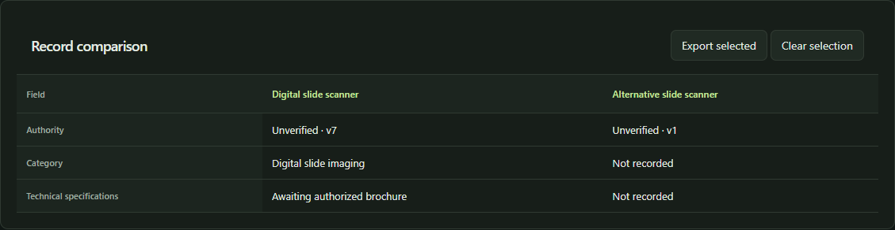
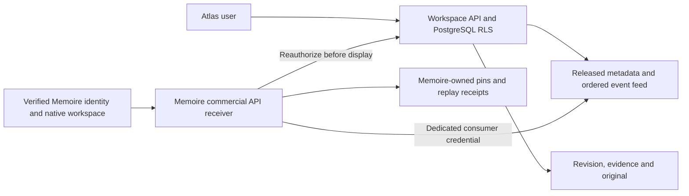

# Atlas continuation milestone

## Architecture

The Atlas schema and private original store remain independent. New workspace templates shape the editor. Locally accepted DOCX body text and first-sheet XLSX values enter the existing scoped passage index. The new citation endpoint returns up to twelve relevant passages with their file/source, asset ID, revision, claim type and verification. Text content is rendered as data. No model acts on it.

## Implementation and verification

| Status | Capability | Evidence or boundary |
|---|---|---|
| Verified | Eight-module navigation audit | Inspected the running baseline in Chromium and captured each page. The graph needed a first selection, research entry repeated domain/type selection, and database comparison required opening records separately. |
| Verified | Pilot research workflow | 22 workspace templates for scientific products, academic institutions, labs, sizing, competitors, pricing and GTM. Existing data is preserved. An idempotent setup adds a fictional lab and histology, molecular and cell biology application records. |
| Verified | Comparison, retrieval and import | Up to four structured records per comparison. Selected metadata export, reloadable scoped asset URLs, role-aware review transitions, accent-insensitive Vietnamese lookup and a separate validation step before browser import. |
| Verified | Security and recovery | Database-enforced 64 MiB default per-workspace original-file quota, transaction-safe upload rejection, server-side sign-in throttling, hashed credential rotation and a disposable PGlite backup/restore drill. Existing RLS and session controls remain in place. |
| Verified isolated integration | Memoire | Its commercial API verifies the configured Memoire login and native workspace, obtains the resolved owner, verifies the Atlas consumer and organization/workspace, then pins released asset versions in Memoire. A fresh authorized read precedes every response. |
| Planned | HELM, Sentinel, Forge | HELM may reference approved strategy, Sentinel may offer evidence for review, Forge may reference a released version. Current source heads matched the compatibility audit. Each needs a receiver owner, disclosure agreement and mapping. |
| Blocked | Flow | The organization inventory still has no identified Flow implementation or endpoint. |
| Partial | Documents and staging | The preview supports bounded original files, text, DOCX body text (XML part up to 1 MiB) and XLSX first-sheet text. Extraction is capped at 64,000 characters. PDF/PPTX remain originals only. The hosted handler suspends binary intake and downloads pending scanning. Hosted auth, file limits and recovery remain untested. |
| Deferred | Advanced intelligence and inline editing | Optional model synthesis, semantic search, OCR and inline bulk edits. Governed edits retain version checks in the asset editor. |

The product owner subsequently reported PASS for four synthetic pilot workflows and no UX blockers. The closure report records the scope of acceptance and separate automated regression results. [UAT closure](uat-closure.md)

## Identity and isolated receiver

The explicit mapping contains the Memoire login subject, native workspace and resolved data-owner UUID; the Atlas origin, organization and workspace UUIDs; and an exact service principal UUID. Memoire verifies the user token with its configured issuer. Atlas verifies its own credential, membership and consumer role. A mismatched scope fails closed. Operator-controlled mapping JSON and the independent consumer credential stay server-side. Human identity is not derived from the consumer credential.

The receiver runs inside Memoire's existing commercial API function. A pin stores only the asset ID and revision under the mapped owner, organization and workspace. Receipts deduplicate event IDs before the remote checkpoint advances. If an asset is unpublished, archived or inaccessible, GET withholds the pinned metadata. A historical pointer can survive withdrawal. Re-pin a known asset to reconcile a missed update. Polling and user-facing receiver navigation remain operational work.

The cross-repository test uses the real receiver module, Memoire native scope functions, real receipt SQL, the Supabase JS client and the Atlas HTTP API. Its local HTTP fixture substitutes for the hosted Supabase Auth/PostgREST transport. The tests exercise changed metadata, replay after a failed acknowledgement, reconciliation, withdrawal, archive and wrong user/workspace. The older Atlas-only consumer remains a separate regression. The Memoire branch is pinned by SHA in Atlas CI.

## Quality evidence

- Production TypeScript/Vite build, contract drift check, 19 local tests including recovery, and 18 native PostgreSQL API tests. The native application connection is a non-owner login. The database cluster uses UTF-8 for Vietnamese normalization.
- Browser E2E at 1440×960 and 390×844 covers creation from a template, private evidence, revision history, refresh, import preview, saved views, comparison, graph navigation, citation results and unsupported queries. [Desktop overview](qa/phase2/overview-desktop.png) · [Graph](qa/phase2/graph-desktop.png) · [Mobile](qa/phase2/overview-mobile.png).
- Atlas npm audit reported zero advisories across its dependency tree. Memoire's production dependency audit reported zero. Its existing full development tree reported eight moderate and three high advisories. This receiver adds no Memoire dependency.
- Memoire's issuer and workspace hook still require hosted validation. The throttling limit is 30 login submissions per observed socket address per minute, including successful logins. A reverse proxy may share that allowance. Validate trusted ingress configuration before hosting.
- No hosted staging target was approved. Both PRs are drafts and the original Atlas PR remains separate. [Memoire draft PR](https://github.com/enexiaplatform/memoire/pull/21).

## Release priorities

1. For a future real-data evaluation, agree on authorized materials and the evidence required for each use case.
2. Approve isolated hosting, issuer subjects, native workspace mappings and the dedicated consumer credential.
3. Rehearse hosted authentication, publication withdrawal, backup recovery, rate limiting and file limits.
4. Add malware quarantine and scanning before enabling hosted binary access.
5. Assign synchronization operations and remediate the inherited Memoire development dependency advisories.
